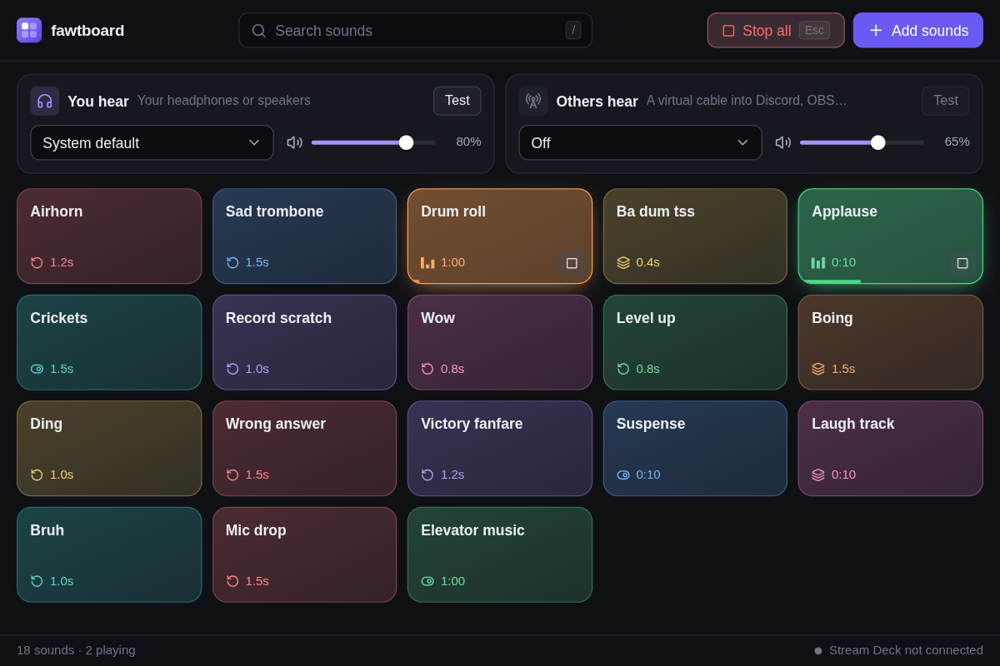

# fawtboard

A soundboard for Windows with a Stream Deck plugin. Every sound plays to two outputs at once: one you hear, and one that feeds a virtual cable so other people hear it in Discord, OBS and similar apps.



| Path                     | What it is                                                     |
| ------------------------ | -------------------------------------------------------------- |
| `apps/desktop`           | The Electron app: the board, the audio engine, the tray icon   |
| `apps/streamdeck-plugin` | The Stream Deck plugin: **Play Sound** and **Stop All Sounds** |
| `packages/protocol`      | Messages the plugin and the app exchange over WebSocket        |

## Install

Releases are built for Windows 10 and 11. The plugin needs the Elgato Stream Deck app 7.1 or newer. Every option below installs the [latest release](https://github.com/Nick2191/fawtboard/releases/latest), and running one again updates in place without touching your board or settings.

### PowerShell (recommended)

```powershell
# The app: installs for your user only (no admin prompt) and starts it in the tray
irm https://raw.githubusercontent.com/Nick2191/fawtboard/main/scripts/install.ps1 | iex

# The Stream Deck plugin: hands it to Stream Deck, which installs it
irm https://raw.githubusercontent.com/Nick2191/fawtboard/main/scripts/install-streamdeck-plugin.ps1 | iex
```

`irm` downloads the script and `iex` runs it. Read [scripts/install.ps1](scripts/install.ps1) and [scripts/install-streamdeck-plugin.ps1](scripts/install-streamdeck-plugin.ps1) first if you like; each is about 20 lines.

### Command Prompt

```bat
powershell -c "irm https://raw.githubusercontent.com/Nick2191/fawtboard/main/scripts/install.ps1 | iex"
powershell -c "irm https://raw.githubusercontent.com/Nick2191/fawtboard/main/scripts/install-streamdeck-plugin.ps1 | iex"
```

### curl

`curl.exe` ships with Windows 10 and 11. Download the script, then run it:

```bat
curl.exe -fsSL https://raw.githubusercontent.com/Nick2191/fawtboard/main/scripts/install.ps1 -o "%TEMP%\fawtboard-install.ps1"
powershell -ExecutionPolicy Bypass -File "%TEMP%\fawtboard-install.ps1"

curl.exe -fsSL https://raw.githubusercontent.com/Nick2191/fawtboard/main/scripts/install-streamdeck-plugin.ps1 -o "%TEMP%\fawtboard-plugin.ps1"
powershell -ExecutionPolicy Bypass -File "%TEMP%\fawtboard-plugin.ps1"
```

In PowerShell, type `curl.exe` rather than `curl`, which Windows PowerShell maps to `Invoke-WebRequest`.

### Download by hand

From the [latest release](https://github.com/Nick2191/fawtboard/releases/latest):

1. Run `fawtboard-<version>-setup.exe`. It isn't code-signed, so SmartScreen may stop it: choose **More info** → **Run anyway**.
2. Double-click `com.nick2191.fawtboard.streamDeckPlugin` to install it in Stream Deck.

### Build from source

Clone, build both installers and install them yourself; see [Build it yourself](docs/new-machine-setup.md#3-build-it-yourself-optional). This is also the way to run fawtboard on macOS or Linux, which have no releases.

## After installing

- Pick your outputs and set up Stream Deck keys: [Install](docs/new-machine-setup.md#1-install).
- Moving from another machine: [Bring your board across](docs/new-machine-setup.md#4-bring-your-board-across-optional).
- Using the app: [apps/desktop/README.md](apps/desktop/README.md).

## Updates

Each push to `main` that changes code publishes a new release. The app checks every hour and downloads new versions in the background. When one is ready, it shows a notification, an arrow button in the toolbar and a tray menu item, and installs when you choose. Turn on **Settings → Updates → Install updates automatically** to have updates install when fawtboard quits or next starts.

The app also bundles the matching Stream Deck plugin, and offers to install it when the plugin you have is older. [docs/new-machine-setup.md](docs/new-machine-setup.md#2-updates) has the details.

## Uninstall

- App: Windows Settings → Apps → Installed apps → fawtboard → Uninstall. Your board stays in `%APPDATA%\fawtboard`; delete that folder too to remove it.
- Plugin: in Stream Deck, open Preferences → Plugins, select fawtboard and remove it.

## Development

```bash
npm install
npm run dev -w @fawtboard/desktop                 # app with hot reload
npm run watch -w @fawtboard/streamdeck-plugin     # plugin, restarted in Stream Deck on change
npm run pack -w @fawtboard/streamdeck-plugin      # build the plugin first: the app bundles it
npm run build:win -w @fawtboard/desktop
```

[.github/workflows/release.yml](.github/workflows/release.yml) builds and publishes releases. [scripts/stamp-version.mjs](scripts/stamp-version.mjs) sets their version numbers from the commit count, so nobody bumps versions by hand.
