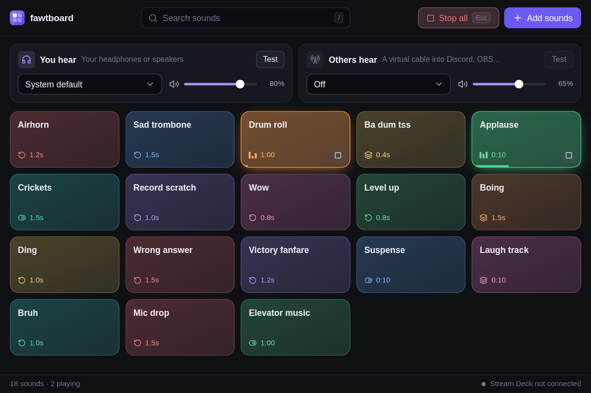

# fawtboard desktop

A lightweight soundboard. Every sound plays to two outputs at once: one you hear, and one that feeds a virtual cable so other people hear it in Discord, OBS and similar apps.



## Using it

- **Add sounds**: drop audio files anywhere in the window, or use **Add sounds**. MP3, WAV, FLAC, OGG and M4A are supported. Files are used in place, not copied.
- **Play**: click a pad. A playing pad shows its progress and a stop button.
- **Edit**: right-click a pad, or use its **⋯** button, to change its name, image, color, volume, play mode or file.
- **Images**: a sound's image shows on its pad and, automatically, on any Stream Deck key set to that sound. PNG, JPEG, WebP, GIF, BMP and AVIF work; the picture is cropped to a square and a copy is kept in the app's data folder, so the original can be moved or deleted.
- **Reorder**: drag a pad, or focus it and press Alt+Left / Alt+Right.

**Settings** (the gear button) has four sections:

- **Audio**: pick a device and volume for **You hear** and **Others hear**. **Test** plays a short tone on that output only. The status bar shows where each output is going.
- **Library**: choose whether the **Add sounds** file picker opens in the folder you last added from, or always in one folder you pick.
- **Appearance**: System, Light or Dark theme, and an accent color.
- **Updates**: the running version, a downloaded update or Stream Deck plugin update waiting to install, and **Install updates automatically**. An arrow button in the toolbar opens it when something is waiting.

Closing the window keeps fawtboard running in the tray so Stream Deck keys keep working. Quit from the tray menu.

| Shortcut         | Action                         |
| ---------------- | ------------------------------ |
| `/` or `Ctrl+F`  | Search sounds                  |
| `Ctrl+O`         | Add sounds                     |
| `Ctrl+,`         | Settings                       |
| `Esc`            | Stop all sounds / clear search |
| `Alt+←`, `Alt+→` | Move the focused pad           |
| `Ctrl+Q`         | Quit                           |

On macOS use `⌘` in place of `Ctrl`.

To install on a new Windows machine and route sounds into Discord, see [docs/new-machine-setup.md](../../docs/new-machine-setup.md).

## Development

Run these from the repository root after `npm install`:

```bash
npm run dev -w @fawtboard/desktop        # app with hot reload
npm run typecheck -w @fawtboard/desktop
npm run lint -w @fawtboard/desktop
npm run build:win -w @fawtboard/desktop  # also build:mac, build:linux; run `npm run pack -w @fawtboard/streamdeck-plugin` first, the app bundles the plugin
```

The Stream Deck plugin connects on port 39217. To run a development copy beside an installed one, start it with `FAWTBOARD_PORT=39218` so the two don't fight over the port. The plugin always uses 39217.

App icons are generated from `build/icon.svg` by `scripts/generate-icons.sh`.
